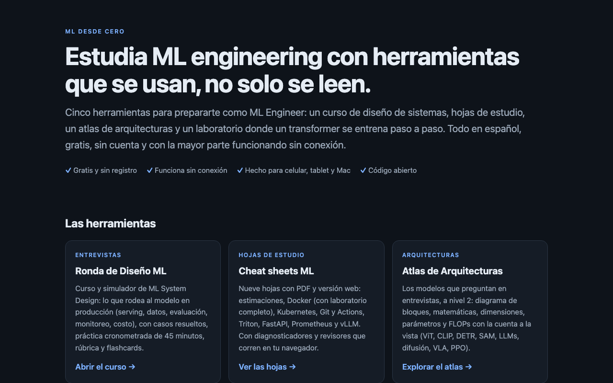
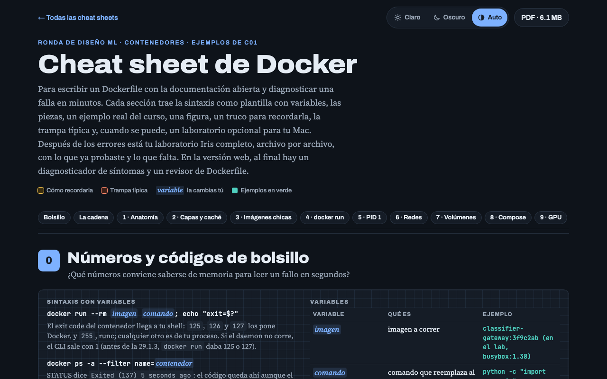
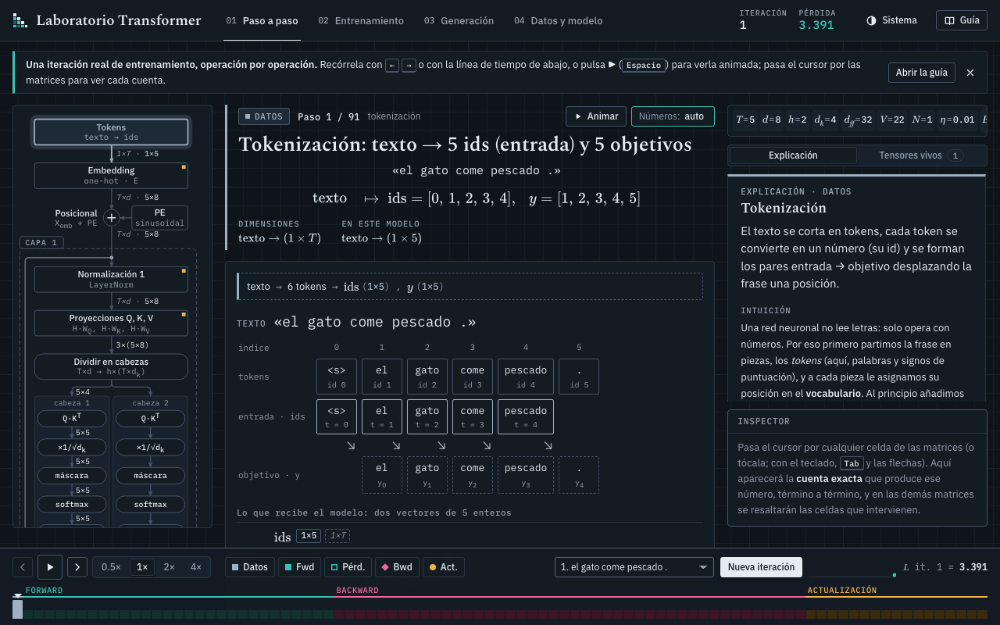
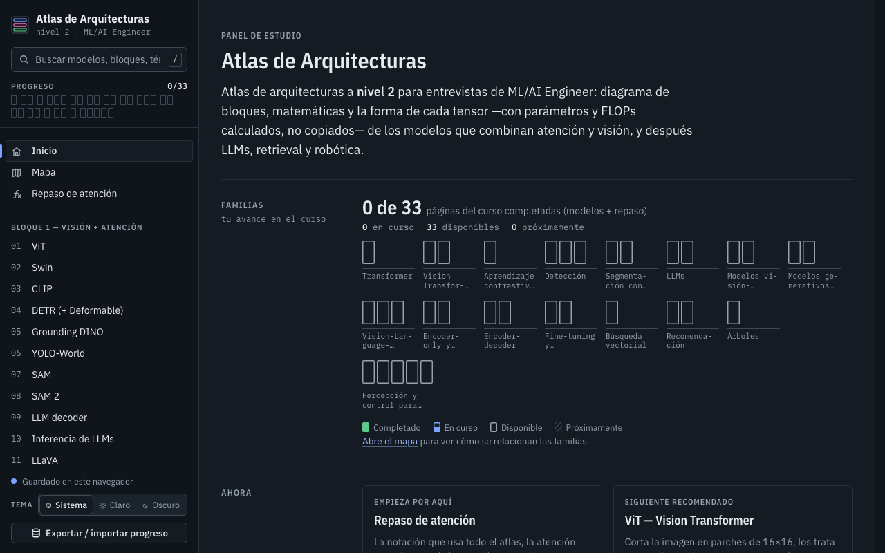
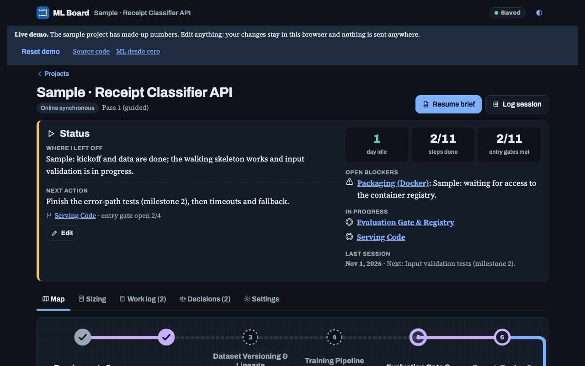

# ML desde cero

**Español** · [English](#english)

Herramientas gratuitas, en español y sin cuenta para prepararte como **ML Engineer**: un curso de ML System Design, hojas de estudio, un atlas de arquitecturas, un laboratorio donde un transformer se entrena paso a paso y un tablero para llevar tus proyectos. Casi todo funciona **sin conexión** y se lee bien en celular, tablet y Mac.

**Portada:** https://ml-desde-cero.vercel.app

[](https://ml-desde-cero.vercel.app)

## Qué hay

| | Qué es | Pruébalo |
|---|---|---|
| **Ronda de Diseño ML** | Curso y simulador de la ronda de ML System Design: serving, datos, evaluación, monitoreo, costo. Casos resueltos, práctica cronometrada de 45 minutos, rúbrica y flashcards. | [ronda-diseno-ml.vercel.app](https://ronda-diseno-ml.vercel.app) · [código](apps/ml-system-design) |
| **Cheat sheets ML** | Nueve hojas con PDF y versión web: estimaciones, Docker (con laboratorio completo), Kubernetes, Git y Actions, Triton, FastAPI, Prometheus y vLLM. Diagnosticadores y revisores que corren en tu navegador. | [cheat-sheets-ml.vercel.app](https://cheat-sheets-ml.vercel.app) · [código](apps/cheat-sheets) |
| **Atlas de Arquitecturas** | Los modelos que preguntan en entrevistas, a nivel 2: diagrama de bloques, matemáticas, dimensiones, parámetros y FLOPs con la cuenta a la vista. | [atlas-arquitecturas.vercel.app](https://atlas-arquitecturas.vercel.app) · [código](apps/atlas-arquitecturas) |
| **Laboratorio Transformer** | Un transformer pequeño entrenándose operación por operación (forward, pérdida, backward, actualización), calculado en tu navegador con cada matriz y su fórmula. | [laboratorio-transformer.vercel.app](https://laboratorio-transformer.vercel.app) · [código](apps/transformer-lab) |
| **ML Board (demo)** | Un tablero con un mapa de metro por proyecto, del dato al monitoreo, con criterios de entrada que se verifican. La demo usa un proyecto inventado y guarda todo en tu navegador. | [tablero-ml-demo.vercel.app](https://tablero-ml-demo.vercel.app) · [código](apps/tablero-ml) |

<table>
<tr>
<td width="50%"><a href="https://cheat-sheets-ml.vercel.app/docker/"></a></td>
<td width="50%"><a href="https://laboratorio-transformer.vercel.app"></a></td>
</tr>
<tr>
<td width="50%"><a href="https://atlas-arquitecturas.vercel.app"></a></td>
<td width="50%"><a href="https://tablero-ml-demo.vercel.app"></a></td>
</tr>
</table>

## Cómo está hecho

- **Sitios estáticos, sin framework y casi sin dependencias.** HTML, CSS y JavaScript; cada app arma su carpeta `dist/` con un script de Node.
- **Los motores corren en el navegador:** el parser de protobuf de `config.pbtxt`, los revisores de YAML, Dockerfile y workflows, el motor de cálculos del tablero y el transformer completo (forward y backward escritos a mano, sin librerías de ML).
- **Sin conexión:** service worker en cada sitio; el progreso y las notas viven en el navegador (`localStorage`), nunca en un servidor.
- **Verificado:** pruebas con `node --test`, chequeos en Chrome (celular, tablet, claro y oscuro, sin conexión) y una revisión de enlaces y SEO de los sitios en vivo (`apps/portada/tools/qa.mjs`). El Atlas se contrasta con PyTorch.
- **Hecho con [Claude Code](https://claude.com/claude-code):** el contenido y el código se construyeron en sesiones con Claude Code, con revisión y verificación de las cifras contra la documentación oficial.

## Estructura

```
apps/
  portada/              portada común, aviso de privacidad, imágenes para redes, revisión de los sitios en vivo
  ml-system-design/     Ronda de Diseño ML (curso y simulador)
  cheat-sheets/         hojas de estudio con PDF
  atlas-arquitecturas/  Atlas de Arquitecturas
  transformer-lab/      Laboratorio Transformer
  tablero-ml/           ML Board (versión de un solo usuario con API y base de datos)
  tablero-demo/         la demo pública del tablero, sin servidor
docs/                   plan de lanzamiento, guía de la beta, borradores de publicaciones
```

## Correrlo en tu máquina

Con Node 20 o más nuevo. Cada app tiene su propio `README.md` con los detalles.

```bash
# Ronda de Diseño ML, Atlas y Laboratorio Transformer: abre index.html con doble clic (funciona desde el disco)
cd apps/transformer-lab && npm test          # pruebas del motor
cd apps/cheat-sheets && npm run build        # arma dist/ con la portada y las hojas
cd apps/tablero-demo && npm test             # arma y prueba la demo del tablero
cd apps/portada && node tools/qa.mjs         # revisa los sitios publicados (enlaces, SEO, imágenes)
```

## Comentarios y errores

¿Encontraste un error, algo confuso o una hoja que te falta? [Abre un comentario](https://github.com/ErikPalacios/ML_from_scratch/issues/new/choose): hay plantillas para errores de contenido, fallas de la app y sugerencias. Lo hace una persona; las respuestas llegan en lotes semanales.

## Licencia

- **Contenido** (textos, figuras, preguntas, casos, PDF): [CC BY-NC-ND 4.0](LICENSE-CONTENIDO.md). Puedes compartirlo con atribución; no usarlo comercialmente ni publicarlo modificado. Si quieres traducirlo o usarlo en una clase, escríbeme.
- **Código:** [MIT](LICENSE).
- [Aviso de privacidad](https://ml-desde-cero.vercel.app/privacidad/): las apps no piden cuenta ni usan cookies de publicidad.

---

## English

**ML desde cero** ("ML from scratch") is a set of free, no-signup study tools for **ML Engineer** interviews and production work, written in **Spanish**: an ML System Design course, cheat sheets, an architecture atlas, a lab where a small transformer trains step by step, and a project board. Most of it works **offline** and is readable on a phone, tablet or Mac.

**Landing page:** https://ml-desde-cero.vercel.app

| | What it is | Try it |
|---|---|---|
| **Ronda de Diseño ML** | Course and simulator for the ML System Design round: serving, data, evaluation, monitoring, cost. Worked cases, timed 45-minute practice, rubric, flashcards. | [live](https://ronda-diseno-ml.vercel.app) · [code](apps/ml-system-design) |
| **Cheat sheets ML** | Nine sheets with PDF and web versions: estimation formulas, Docker (full lab), Kubernetes, Git & Actions, Triton, FastAPI, Prometheus, vLLM. Diagnosers and linters that run in the browser. | [live](https://cheat-sheets-ml.vercel.app) · [code](apps/cheat-sheets) |
| **Architecture Atlas** | The models asked in interviews, at "level 2": block diagrams, math, tensor shapes, parameter and FLOP counts with the arithmetic shown. | [live](https://atlas-arquitecturas.vercel.app) · [code](apps/atlas-arquitecturas) |
| **Transformer Lab** | A small transformer training one operation at a time (forward, loss, backward, update), computed in your browser with every matrix and formula. | [live](https://laboratorio-transformer.vercel.app) · [code](apps/transformer-lab) |
| **ML Board (demo)** | A per-project "metro map" from data to monitoring with entry gates that verify your sizing. The demo uses a made-up project and keeps everything in your browser. | [live](https://tablero-ml-demo.vercel.app) · [code](apps/tablero-ml) |

**How it is built.** Static sites with no framework and almost no dependencies (HTML, CSS, JavaScript; a Node script builds each `dist/`). The engines run client-side: a protobuf-text parser, YAML/Dockerfile/workflow linters, the board's calc engine, and the whole transformer (forward and backward written by hand, no ML library). Every site has a service worker; progress and notes live in `localStorage`, never on a server. Checked with `node --test`, Chrome checks (phone, tablet, light/dark, offline) and a link/SEO crawl of the live sites (`apps/portada/tools/qa.mjs`); the Atlas is cross-checked against PyTorch. Built with [Claude Code](https://claude.com/claude-code), with figures verified against official documentation.

**Run locally.** Node 20+. Open `index.html` of the course, atlas or lab directly, or see each app's `README.md`.

**Feedback.** [Open an issue](https://github.com/ErikPalacios/ML_from_scratch/issues/new/choose) (templates for content errors, app bugs and suggestions). It is a one-person project; replies come in weekly batches.

**License.** Content: [CC BY-NC-ND 4.0](LICENSE-CONTENIDO.md) (share with attribution, no commercial use, no modified copies; ask me if you want to translate or adapt it). Code: [MIT](LICENSE). The apps need no account and use no advertising cookies ([privacy notice](https://ml-desde-cero.vercel.app/privacidad/), in Spanish).
